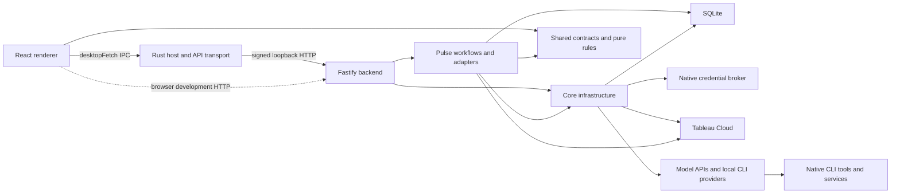

# Maintain Pulse Metric Studio

Pulse Metric Studio is a local desktop workbench for Tableau Pulse authoring, publication, and management.
The local browser server is a development and test harness, not a separate hosted product.
This guide describes current maintained source.
The [architecture audit](ARCHITECTURE_AUDIT.md) records an examined snapshot; this guide owns current runtime contracts.

## Start here

Read these pages in order:

1. [README](../README.md) for product scope, installation, and user-visible capability boundaries.
2. [Contributing](../CONTRIBUTING.md) for prerequisites, development, checks, packaging, and release commands.
3. This guide for composition, operation flows, trust boundaries, and feature placement.
4. [SQLite contract](PULSE_SQLITE.md) for durable records, migration, credentials, and recovery.
5. [Architecture audit](ARCHITECTURE_AUDIT.md) for examined evidence, coverage limits, and proposed changes.

[Transfer verification](TRANSFER_VERIFICATION.md) records an earlier transfer snapshot.
Its results do not qualify subsequent releases or working-tree changes.

## Runtime and composition

The installed app has a Rust host, an embedded React renderer, and one bundled Node backend.
The backend is a composition of workspace packages rather than independently deployed services.
External Tableau and model services remain authoritative for their own remote resources and account policies.



The renderer and IPC edges are implemented by [`desktopFetch`](../packages/web/src/desktop-transport.ts) and native [`PulseTransport`](../src-tauri/src/pulse_transport.rs).
Local providers can use their native tools; HTTP adapters do not provide an app tool loop.
[`main`](../packages/server/src/index.ts) passes Pulse hooks to [`buildApp`](../packages/server/src/app.ts), which registers core Tableau/provider routes and Pulse routes.
[`registerPulseRoutes`](../packages/pulse/src/pulse/routes.ts) composes workflow and registry endpoints.
Database edges belong to [`PulseRepository`](../packages/pulse/src/persistence/repository.ts) and the core stores documented in the [SQLite contract](PULSE_SQLITE.md).
The broker edge uses [`createCredentialBrokerClient`](../packages/core/src/tableau/credential-broker.ts) and native [`start_credential_broker` and `CredentialBrokerHandle`](../src-tauri/src/credential_broker.rs).
The Tableau edges use the core REST/metadata clients and Pulse provider adapters; provider edges are selected by [`ProviderRegistry`](../packages/core/src/llm/registry.ts).

The native launcher locates a compatible bundled Node runtime, passes startup secrets over stdin, checks backend readiness, and then creates the window.
It owns single-instance behavior, tray/window state, shutdown, and the updater.
The backend owns a local socket derived from its canonical data directory to prevent concurrent desktop ownership.
Startup fails if that socket is already held, including an unrelated local port collision.
See [`main`](../src-tauri/src/main.rs) and [`readDesktopStartup`, `acquireDesktopOwnership`, and `superviseDesktop`](../packages/server/src/desktop.ts).

## Configuration and trust boundaries

[`loadRepoEnv` and `config`](../packages/core/src/config.ts) resolve `.env` relative to the module layout and capture configuration at module initialization.
Existing process environment values take precedence over `.env`; defaults apply to absent or empty values.
Development resolves the repository `.env` and `data` directory, while the desktop launcher supplies its absolute app-data directory and loopback address.
Changing the process environment later does not rebuild the exported configuration object.
The [SQLite contract](PULSE_SQLITE.md#state-ownership-and-location) owns storage-location details.

[`ProviderRegistry.profiles` and `activePreference`](../packages/core/src/llm/registry.ts) combine explicitly enabled environment profiles with saved profiles.
A saved profile replaces an environment profile with the same ID.
The saved active choice takes precedence over `PULSE_METRIC_STUDIO_LLM_PROVIDER`; the default preference is OpenCode, but AI still needs a configured model.
There is no automatic provider or model fallback after failure.

Desktop requests use a main-window IPC command with method/path allowlists, bounded JSON bodies, and per-launch credentials unavailable to renderer JavaScript.
The backend verifies HMAC over method, request target, nonce, and timestamp, then rejects replayed nonces and stale timestamps.
The HMAC input does not include the body.
Readiness challenges establish that the loopback peer holds the startup secret.
The OS credential broker has a separate loopback bearer secret delivered through stdin and retained in backend module state.
These boundaries are implemented in [`PulseTransport`](../src-tauri/src/pulse_transport.rs), [`createDesktopRequestVerifier`](../packages/server/src/desktop.ts), and [`credential_broker.rs`](../src-tauri/src/credential_broker.rs).

Browser development uses ordinary HTTP and an origin allowlist, without desktop request authentication or the native credential approver.
Its default address is loopback, but `HOST` is configurable.
It is not an authenticated multi-user hosting boundary.
See [`buildApp`](../packages/server/src/app.ts) and [`isAllowedAppOrigin`](../packages/core/src/cors.ts).

Frontend context changes discard stale responses; they do not establish that remote work stopped.
[`desktopFetch`](../packages/web/src/desktop-transport.ts) checks an abort signal before dispatch and after return but does not cancel an in-flight native invocation.
Backend provider shutdown and Tableau session-generation checks are separate mechanisms described below.

## Ownership and permitted dependencies

| Responsibility | Location | Owns |
|---|---|---|
| Application contracts | `packages/shared/src/pulse-contracts.ts` | Validated app requests, documents, plans, and receipts |
| Pure authoring rules | `packages/shared/src/pulse-domain.ts` | Document edits and responsive validation without network or database access |
| HTTP boundary | `packages/pulse/src/http` | Parse requests, invoke named workflows, return structured errors |
| Application workflows | `packages/pulse/src/application` | Revision checks, proposals, publication, inventory, subscriptions, previews, and deletion planning |
| Persistence | `packages/pulse/src/persistence` | SQL, migration, document revisions, durable publication outcomes |
| Tableau integration | `packages/pulse/src/adapters`, `packages/pulse/src/pulse`, and `packages/core/src/tableau` | Provider serialization, Pulse transport, variant services, REST sessions, and field metadata |
| Presentation | `packages/web/src/features/pulse` | Connections, Author, Metric Manager, Activity, and their local controllers |
| Desktop host | `src-tauri` | Native credentials, authenticated API bridge, child process lifecycle |
| Host infrastructure | `packages/core` and `packages/server` | Runtime capabilities and Pulse registration |

The frontend talks to the backend API.
Backend repositories own SQLite access, and backend adapters construct Tableau requests.
Shared app contracts describe user intent; provider payloads stay behind the backend boundary.
Pure validation can run in the frontend for immediate feedback, and the backend independently enforces the rules using current metadata.
The shell owns navigation, page headers, and assistant sizing.
Author owns inline metric editing and proposal review; Metric Manager owns selected source metrics and the variant dialog.
Proposal review and acceptance use the same merge rules, and the shared document diff describes the changes that will apply.
New metrics default to over-time data mode with a daily minimum granularity.
The app owns the initial month-to-date timeframe and data mode; assistant operations preserve manually selected data modes.
Assistant instructions permit a coarser minimum only for an explicit user request or field metadata that states daily data is unavailable.
Schema parsing strips unsupported assistant properties before applying edits.

Run `npm run check:architecture` after moving responsibilities.
The guard checks forbidden imports, frontend provider serialization, and direct database or network access in pure/workflow code.
Use the guard alongside code review.

Draft and receipt list endpoints return bounded summaries, with `offset`, `limit`, `q`, and a total count.
The default page size is 50 and the maximum is 100.
Repository queries search saved configurations and publication history.
Open a selected record through its detail endpoint.

## State and durability

| State | Lifetime and recovery owner |
|---|---|
| Authoring workspace and publication receipt | Durable SQLite records owned by `PulseRepository`; revisions and admitted commands survive restart. |
| Saved connections and AI profiles | Durable core records with OS-secret references or explicitly selected local fallback; details belong to the SQLite contract. |
| Active Tableau session and metadata/inventory caches | Backend memory; generation and context checks reject stale ownership, and caches expire or invalidate. |
| Pending proposal, rendered preview, registry mutation results, and open controllers | Frontend/backend operation memory; restart does not recover these as publication receipts. |
| Local CLI tool actions | Owned by the CLI and external tools; direct effects are outside app proposal review, publication receipts, and undo. |
| Update channel and prior updater error | App-data files owned by the installer/native updater; they are separate from SQLite. |

The [SQLite contract](PULSE_SQLITE.md) defines persistent entities, transaction boundaries, migration backups, and destructive legacy compatibility policies.
Transient state is implemented by the web controllers, [`application/inventory.ts`](../packages/pulse/src/application/inventory.ts), [`tableau/session.ts`](../packages/core/src/tableau/session.ts), and [`updater.rs`](../src-tauri/src/updater.rs).

## Trace connection and metadata access

The connection UI uses native credential commands to store or replace a secret and sends an opaque reference through the app API.
Browser development offers an explicitly selected encrypted local fallback.
[`registerTableauRoutes`](../packages/core/src/tableau/routes.ts) resolves the chosen credential and verifies sign-in before committing connection changes.
Credential mutations have operation identities so the frontend can reconcile a lost response before compensating a newly stored secret.
Activation and disconnection use connection identity and session generation to protect a newer activation from an older request.
See [`tableau-connections-api.ts`](../packages/web/src/tableau-connections-api.ts), [`routes.ts`](../packages/core/src/tableau/routes.ts), and [`session.ts`](../packages/core/src/tableau/session.ts).

Field discovery prefers VDS metadata and uses the Metadata API fallback where supported by the response.
Raw provider field IDs remain the catalog identity used by authoring and serialization.
Caches are partitioned by connection context; a failed or partial provider read cannot establish that Tableau contains no matching content.
[`tableauFetch`](../packages/core/src/tableau/rest-client.ts) owns registered-session checks, concurrency admission, authentication refresh, version adaptation, and bounded throttling retries.
Read and mutation retries have different safety rules; an ambiguous write is not a confirmed rejection.
See [`getFieldCatalog`](../packages/core/src/tableau/vds-fields.ts) and [`metadata-fallback.ts`](../packages/core/src/tableau/metadata-fallback.ts).
The [audit findings](ARCHITECTURE_AUDIT.md#findings-and-recommendations) identify response paths that bypass the common body-size limit and pagination limits that need further qualification.

## Trace a publication

1. Choosing a datasource restores its authoring configuration using immutable connection, server, site, and datasource coordinates.
2. Edits save with an expected revision.
   SQLite updates only when that revision still matches.
3. Assistant output proposes changes against a captured document.
   Explicit acceptance merges compatible changes while preserving manual property locks and newer edits or removals.
   Conversation survives proposal discard; requests use current input even when background saving fails.
4. Publication saves the intended document and asks the backend to review that exact revision.
5. The backend refreshes datasource metadata, validates meaning, serializes provider requests, and returns a preview fingerprint.
6. The approved command includes the revision, fingerprint, and a new command ID.
7. Before any remote write, one local transaction records the run, every intended definition, the chosen audience, and the original site content URL.
8. The backend records each confirmed remote ID before optional group and subscription work.
9. Author displays a result dialog with creation counts, diagnostics, and actions.
   Activity retains the complete receipt while disconnected.

Publication verifies the initial metric's month-to-date timeframe through Tableau reads before resolving it for group subscriptions.
An unexpected timeframe retains the confirmed definition and records a resolution diagnostic.
Digest groups use `pmStudio - Datasource Name - chosen name`, with the complete datasource and audience labels.
The transport escapes XML while preserving the group name.
Group actions use recorded group IDs and publication ownership.

For a new rule, add pure validation in `packages/shared/src/pulse-domain.ts` and verify the relevant UI workflow.
Use [`pulse-domain.test.ts`](../packages/shared/src/pulse-domain.test.ts) for pure rules, [`pulse-workflows.test.ts`](../packages/server/src/pulse-workflows.test.ts) for route integration, and [authoring UI tests](../packages/web/src/features/pulse/author/authoring-ui.test.tsx) for presentation.
For a provider wire change, capture the expected Tableau payload fixture before changing serialization.

The UI entry is [`PublishSection`](../packages/web/src/features/pulse/components/PublishSection.tsx), which uses [`createAuthorController`](../packages/web/src/features/pulse/author/controller.ts) and the [`pulseApi`](../packages/web/src/features/pulse/api/client.ts) client.
Backend owners are [`PulseProposalService`](../packages/pulse/src/application/proposals.ts), [`PulsePublishService`](../packages/pulse/src/application/publish.ts), and [`PulseRepository`](../packages/pulse/src/persistence/repository.ts).
Shared [`pulse-domain.ts`](../packages/shared/src/pulse-domain.ts), [`pulse-proposal.ts`](../packages/shared/src/pulse-proposal.ts), and the [`Tableau serializer`](../packages/pulse/src/adapters/tableau/serializer.ts) enforce document and provider constraints at their respective boundaries.

## Handle an interrupted operation

The app does not replay publications when it restarts.
An interrupted request can have a confirmed creation, a confirmed rejection, an unknown outcome, or an item never attempted.
Inventory visibility is separate from creation: a definition can be confirmed while its default metric is still pending.

A repeated submission with the same command ID and reviewed input returns the stored receipt.
Reusing the ID with different input is rejected.
SQLite admission and Tableau writes remain separate operations.

When an outcome is unknown:

1. Keep the receipt and its exact server/site/datasource context.
2. Inspect Tableau using TADX or the provider UI for the named resource and intended configuration.
3. Establish what happened before submitting a new publication.
4. Use exact resource IDs for any cleanup and record the result.

Do not infer that a timeout means failure.
Do not delete reused metrics or groups merely because they appear in a receipt.
Undo compensates confirmed definition creations and rechecks connection ownership.
It is a destructive action against those definitions, including their Tableau dependents; review the displayed scope before using it.
Group deletion is a separate receipt-owned operation for groups confirmed created by that publication.
Author and Activity read the same updated receipt outcomes.

Window close, tray Quit, and operating-system quit requests use the same desktop shutdown flow.
The editor stops accepting changes, waits for current assistant and catalog updates, and saves every open draft before the native host stops the backend.
The user can keep the app open while those changes finish.
After saving finishes, the editor stays disabled until the native host exits.
A failed save keeps the window and edits available.
Closing without saving requires a separate confirmation that identifies the affected drafts.
Browser development warns before navigating away with unsaved draft changes.

The relevant owners are [`desktop-lifecycle.ts`](../packages/web/src/desktop-lifecycle.ts), the [author controller](../packages/web/src/features/pulse/author/controller.ts), the [Activity controller](../packages/web/src/features/pulse/activity/controller.ts), and the [publication service](../packages/pulse/src/application/publish.ts).

## Change Metric Manager behavior

Inventory, variants, subscriptions, and deletion have separate named responsibilities.
Dimension discovery, member counts, and value queries send validated POST bodies so large selections do not exceed desktop URL limits.
Source metric and definition reads use bounded concurrency, and repeated definition reads share one request within the operation.
Date and dimensional variants use the canonical variant endpoint.
Deletion first asks the backend for a plan, then submits the exact selection and plan fingerprint.
A bulk selection containing defaults opens an explicit review of the affected definitions and their metrics.
An ordinary variant selection never authorizes deleting its parent definition.
Incomplete inventory cannot establish that a selection covers every dependent resource.

Metric Manager previews use Tableau's springboard insight and metric card image APIs through the existing authenticated connection.
The backend verifies the exact metric, definition, and datasource before rendering.
The frontend receives a bounded PNG image; Tableau credentials remain in the backend.
PNG decoding and CRC validation use `pngjs`; resource guards reject oversized dimensions, duplicate headers, and unsupported interlaced images before decoding.
Preview images remain in memory and are discarded when the context or inventory changes.
The card uses the unique successful BAN summary sparkline, one successful period-over-period insight, and the highest-scored successful supporting insight.
Tableau supplies the chart, facts, and markup.
Springboard requests specify bundle version `1`; card image requests use Tableau's default locale.
Provider order breaks equal scores.
Missing required insights produce an unavailable state; unrelated partial insight failures can still yield a usable card.
Provider-shaped fixtures cover mapping, permissions, context changes, size limits, and response failures; they do not establish live rendering compatibility.

Keep partial and truncated results visible in the interface.
An empty visible subset is not evidence that a datasource has no definitions.

Registry mutation results and unknown outcomes live in controller memory.
Restart does not recover their reviewed target list or create an Activity publication receipt.
Inspect Tableau before repeating an uncertain variant, follow, or delete request.
The [audit](ARCHITECTURE_AUDIT.md#findings-and-recommendations) proposes durable registry commands without changing current behavior.

| Operation family | Implementation owners |
|---|---|
| Inventory and stale-result handling | [`application/inventory.ts`](../packages/pulse/src/application/inventory.ts), `getExistingMetrics`; [registry controller](../packages/web/src/features/pulse/registry/controller.ts), `createRegistryController` |
| Dimension discovery and variants | [`PulseDimensionalForkService`](../packages/pulse/src/pulse/dimensional-fork-service.ts), [`PulseForkPlanService`](../packages/pulse/src/pulse/fork-plan-service.ts), and [pure variant rules](../packages/pulse/src/domain/variants.ts) |
| Follow state, targets, and mutations | [`application/subscriptions.ts`](../packages/pulse/src/application/subscriptions.ts), `getFollowState`, `followTargets`, and `unfollowTargets` |
| Planned deletion and execution | [`PulseDeletionService`](../packages/pulse/src/application/deletion.ts) and [`executeDeletes`](../packages/pulse/src/application/delete-execution.ts) |
| Metric preview | [`previewPulseMetric`](../packages/pulse/src/application/metric-preview.ts), [PNG/insight mapping](../packages/pulse/src/pulse/metric-preview.ts), and [preview controller](../packages/web/src/features/pulse/registry/preview-controller.ts) |

## Qualify a change

Use the canonical [validation commands and prerequisite ordering](../CONTRIBUTING.md).
The architecture guard enforces selected source patterns; it does not prove complete layering or runtime correctness.

Unit and server integration tests use local fixtures, temporary databases, and controlled provider responses.
Desktop and live Tableau workflow validation is user-led.

CI runs native transport tests and builds Windows and macOS installers on their respective platforms.
A successful build does not establish native runtime qualification.
Before release, qualify installation, upgrade, restart, sleep/wake, credential restoration, and uninstall on each supported operating system.

For user-led live qualification, use an authorized test site and disposable resources.
Record exact resource identifiers, inspect their saved configuration, and confirm cleanup.
Keep credentials, production data, and test evidence outside source control.

## Maintain local account providers

Provider profiles use one storage, registry, API, and settings workflow.
The `codex-cli` and `claude-code` protocols use `local-account` authentication.
Their concrete adapters own CLI discovery, launch validation, headless execution, response parsing, and error classification.
HTTP adapters continue to own API-key and gateway requests.
Pulse authoring receives assistant text through `LlmProvider.complete()` and applies the existing parsing, schema, semantic, and proposal checks.
The app applies those checks to proposed operations before accepting draft changes or publishing through its interface.
Local CLI providers inherit native configuration, instructions, tools, skills, hooks, plugins, and MCP servers unless the user's launch options change them.
Tool actions can read documents, inspect Tableau, and modify external resources directly.
App proposal review, publication receipts, and undo apply only to operations performed through the app's workflows.

Local account profiles store a launch command and an explicit model.
They reject API secrets, credential commands, endpoints, custom headers, and cloud-provider routing fields.
Changing a profile to a local account protocol removes incompatible saved credentials from that profile.
Other profiles retain their credentials, IDs, and configuration.
Deleting a Pulse profile does not sign out its CLI.
Deleting the active profile leaves AI unselected.

The installed CLI owns authentication, refresh, and account switching.
Pulse does not read, copy, or decrypt subscription tokens or credential files.
Multiple profiles for the same CLI share native configuration unless their launch options select different settings.
Passive setup checks inspect launch configuration and supported CLI capabilities without generating text or proving account access.
These checks still execute the configured launcher with help or model-catalog arguments.
An executable wrapper can act before handling those arguments.
Local launchers trust the local app window to configure and execute commands, without the separate native exact-command approval used for HTTP credential commands.
The latter protects that credential-helper workflow; it is not a complete boundary against process execution by a compromised renderer.
No external renderer-compromise path was demonstrated in the [audit reassessment](ARCHITECTURE_AUDIT.md#implementation-follow-up-and-product-decisions).
Only an explicit connection test or authoring request submits a prompt.
Model catalogs are optional provider capabilities.
Codex and Claude Code accept explicit model identifiers; OpenCode discovers its configured catalog.
Opening an existing provider editor can discover models using its original saved launch definition.
Editing a launch command only invalidates its catalog; new or edited definitions require explicit **Reload models**, and stale results cannot validate the changed definition.
Native API-key, OAuth, account, and configured cloud-provider authentication remain available through the CLI.
Pulse does not substitute another API provider, model, credential source, or billing route after a failure.
A successful connection test establishes access to that model at that time.

Each local request uses a direct process launch from the user's home directory, stdin for prompt text, bounded output, and a deadline.
Child environments preserve native configuration and credentials while excluding `PULSE_METRIC_STUDIO_` environment variables.
Launch commands contain an executable and optional prefix arguments; the app adds the headless command, selected model, and response-format options.
The shared parser handles quoted arguments, partially quoted Windows paths, JSON values, and empty quoted arguments without shell evaluation or expansion.
Resolution first tries an unquoted absolute path as one executable for compatibility with existing saved paths containing spaces.
Explicit executable wrappers and interpreter commands are supported; direct `.cmd`, `.bat`, and `.ps1` invocation is unavailable.
Pulse does not add safe mode, unrestricted access, auto-approval, or isolated configuration flags automatically.
Native headless permission handling applies, including restrictions that prevent tool use.
Help checks establish flag availability, not full configuration compatibility.
The offline tests do not establish that a specific installed CLI can complete a live request.
Backend shutdown aborts tracked provider operations and attempts process-tree termination before awaiting completion.
Progress messages never enter the Pulse JSON parser as assistant output.
Intermediate tool events remain separate from the final assistant response; recoverable tool failures do not establish a failed turn.
A successful process exit alone does not establish a valid completion.

These controls do not make the CLI an operating-system security boundary.
The installed executable, vendor authentication machinery, and enforced enterprise policies remain trusted dependencies.
Another process can change shared authentication between requests; Pulse does not lock or replace the vendor's credential store.
Current authentication and setup failures take precedence over saved readiness.
When the CLI does not expose a verified account identity, successful requests remain history instead of establishing persistent green readiness.
Settings stay yellow when saved launch configuration cannot establish persistent account readiness.
Do not claim an atomic subscription-only billing guarantee.

On POSIX, the backend stops the process group even if its original parent has exited.
Windows tree termination depends on a living parent process.
If that parent exits before cancellation, detached descendants cannot be reliably identified through the parent PID.
Forced cleanup bounds shutdown and closes pipes; it does not establish that such a descendant has stopped.
Qualify this behavior with the supported official CLI builds before release.

The Bedrock SDK owns its AWS credential-provider chain separately from these CLI adapters.
Its `credential_process` implementation does not expose cancellation or a process deadline in the installed SDK.
Cancelling an AWS request does not establish that an already running SDK credential helper stops.
This existing dependency limit also prevents a blanket guarantee that backend shutdown cancels every credential-provider operation.

Pulse does not retry a failed account request through an API provider or another model.
Vendor usage limits and enabled usage credits still apply.
Keep sign-in in the vendor's own flow and preserve the installed binary's authentication methods.
Vendor integration and billing conditions are external contracts, not guarantees established by this repository.
Consult the current [Claude Code integration conditions](https://code.claude.com/docs/en/legal-and-compliance), [Claude account billing guidance](https://support.claude.com/en/articles/13189465-log-in-to-your-claude-account), and [Codex authentication documentation](https://learn.chatgpt.com/docs/auth) when qualifying distribution.

Automated adapter tests use fake runtimes and documented output fixtures without contacting vendors.
User-led qualification must cover real account access, quota errors, credential switching, launch options, tool use, managed policies, and cancellation on supported platforms.
The optional CLI can require a newer operating system than Pulse itself.
Build success and offline protocol tests do not establish live subscription entitlement, billing treatment, or native CLI compatibility.

[`ProviderRegistry`](../packages/core/src/llm/registry.ts) owns profile selection, fingerprinted readiness, optional model catalogs, and shutdown tracking.
[`HttpLlmProvider`](../packages/core/src/llm/providers/openai-compat.ts) supports Chat Completions, Responses, and Anthropic Messages contracts; [`BedrockProvider`](../packages/core/src/llm/providers/bedrock.ts) owns Converse requests.
[`guardedFetch`](../packages/core/src/llm/providers/guarded-fetch.ts) checks public addresses at connection time unless the profile explicitly permits a private endpoint and refuses redirects.
[`resolveCredentialCommand`](../packages/core/src/llm/providers/credential.ts) owns native exact-command approval, a short token cache, and bounded helper execution.
Local launch and event handling belong to the [Codex](../packages/core/src/llm/providers/codex-cli.ts), [Claude Code](../packages/core/src/llm/providers/claude-code.ts), and [OpenCode](../packages/core/src/llm/providers/opencode-cli.ts) adapters.
Their shared [runtime helper](../packages/core/src/llm/providers/local-agent-runtime.ts) owns native environment handling and launch resolution.
The shared [launch-command parser](../packages/shared/src/local-launch-command.ts) also validates profile command syntax at the API boundary.
For a provider-settings change, start at [`LlmBadge` and `ProfileEditor`](../packages/web/src/components/LlmSettings.tsx), the shared [`LlmProfileWriteSchema`](../packages/shared/src/llm-contracts.ts), and [`registerLlmRoutes`](../packages/core/src/llm/routes.ts).
[`llm-settings.css`](../packages/web/src/components/llm-settings.css) owns the provider modal's viewport bounds and responsive field layout.
[`requestProposal`](../packages/web/src/features/pulse/author/controller.ts) owns accepted-send composer clearing, while [`ProposalReview`](../packages/web/src/features/pulse/author/ProposalReview.tsx) owns disclosure defaults for each new response.

The current app proposal path uses `PulseProposalService` and a context-bound draft.
The server also registers `/api/llm/author` through core routes, with separate truncation and validation behavior.
The current web application has no production caller for that older endpoint; it remains a registered compatibility surface.
The [audit recommendation](ARCHITECTURE_AUDIT.md#findings-and-recommendations) separates consolidating that ownership from removing compatibility.

## Diagnose failures

For OpenCode, reproduce the same model with an ordinary CLI invocation before diagnosing account access.
Reproduce the configured executable and prefix options before diagnosing native configuration, provider access, or tool permissions.
The app adds no execution-policy flags; user-supplied launch options and native configuration determine tool availability.
The installed OpenCode executable and managed configuration remain trusted dependencies.

Start with the user-visible receipt and its command ID.
For request failures, retain the returned error code or reference and the app version.
Server logs suppress authorization headers and omit request query strings from request serialization.
Disconnect requests identify the connection and session generation they intend to close.
A stale request cannot disconnect a newer activation, including a newer session for the same connection.
Unhandled errors return a reference rather than raw internal exception details.

Activity records publication history.
Share only the minimum receipt and log excerpt needed for diagnosis.
Datasource names, field names, and user instructions can be sensitive even when they contain no credentials.
Assistant requests disclose a size-limited prompt containing datasource field metadata, the current metric and slicer configuration, audience settings, conversation and prior proposal context, and new authoring instructions to the configured model provider.
The app does not add Tableau row data or stored Tableau credentials to the authoring prompt.
Local agents can retrieve additional data through their tools and include it in model requests.
The authoring prompt treats pasted or retrieved content as supporting data and keeps the supplied catalog authoritative for proposed field references.

## Build and release

```sh
npm run tauri:build
```

This builds the app and stages native packaging in a temporary directory, so files used by an already running app are not replaced.
Artifacts are copied to `native-artifacts/` by default.
The native host serves bundled assets and forwards permitted API requests through a restricted native command.
Per-launch secrets are delivered to the child through stdin and remain outside the renderer.
Readiness verifies possession of the secret before normal authenticated requests begin.

The Windows and macOS CI jobs build on their respective platforms.
Signing defaults, release staging, update-channel behavior, and qualification requirements belong to [Contributing](../CONTRIBUTING.md).
Keep a record of the exact source revision, runtime versions, artifact checksums, migration evidence, and native qualification results for each release.

### Isolated native validation

`node scripts/build-native.mjs --validation` builds a test app with a unique identifier.
On Windows it produces a portable executable and accompanying resources; on macOS it produces the configured native bundles.
Its app data, WebView profile, single-instance identity, and credential namespace are separate from the installed product.
The evidence file records its exact executable, identifier, and component hashes.

## Receiving engineer exercise

Before accepting ownership, a receiving engineer should complete these tasks using this guide:

1. Add a validated authoring rule and its tests in the owning modules.
2. Diagnose an uncertain publication from its receipt and confirm its remote outcome.
3. Upgrade a copy of a previous database and verify workspace and receipt preservation and the documented legacy draft deletion.
4. Build the installer and complete the platform release checklist.

Record unclear steps and improve the guide before handoff.
